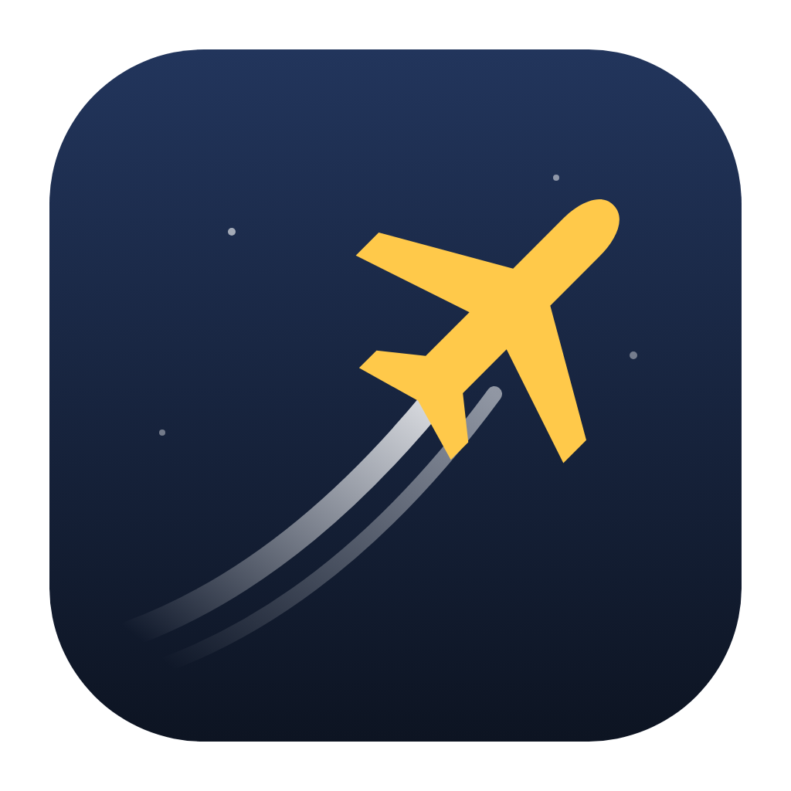
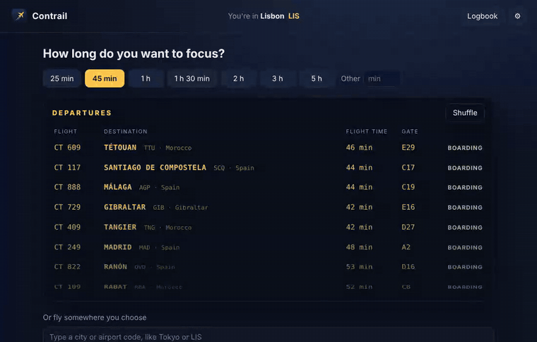
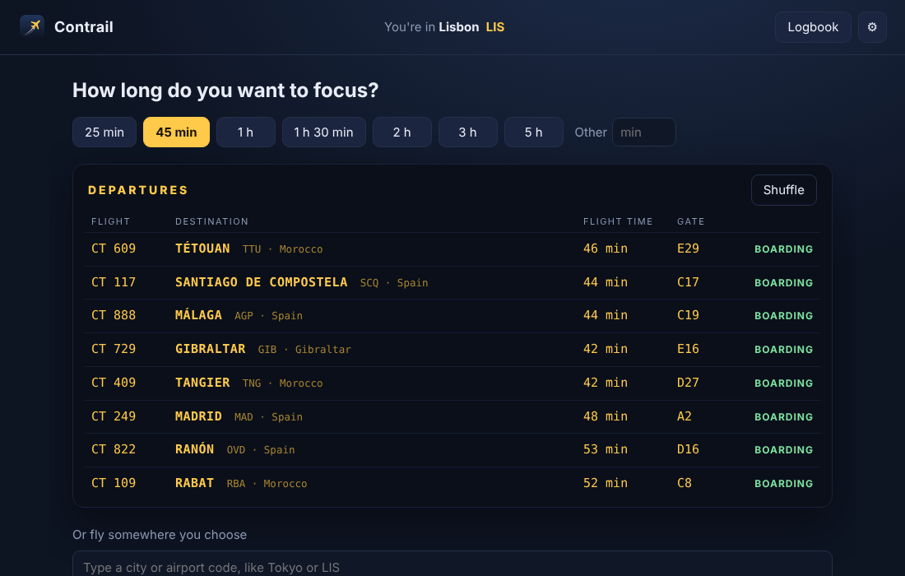
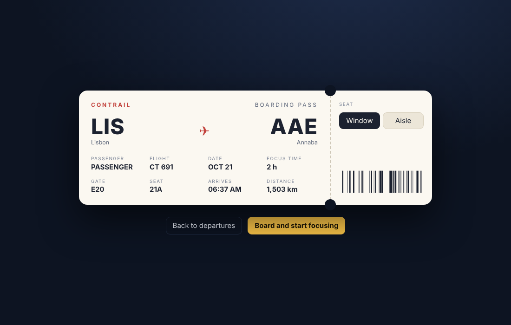
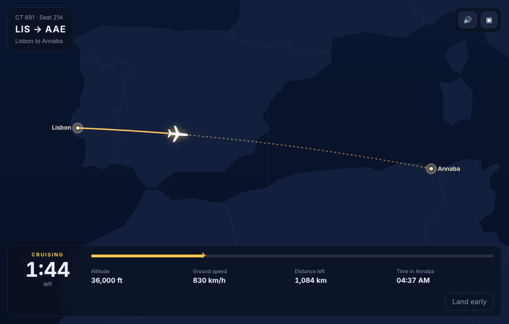
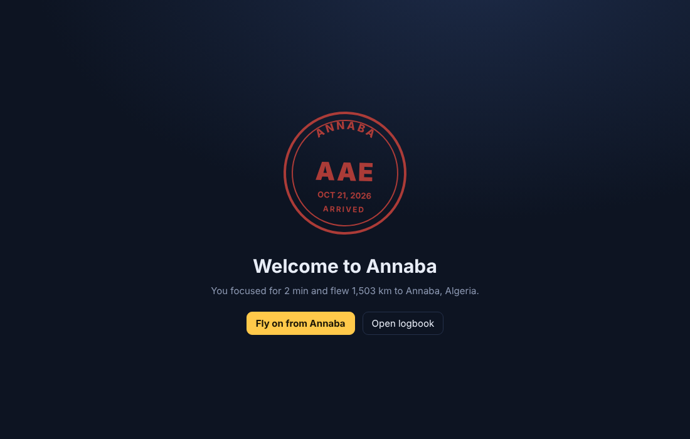
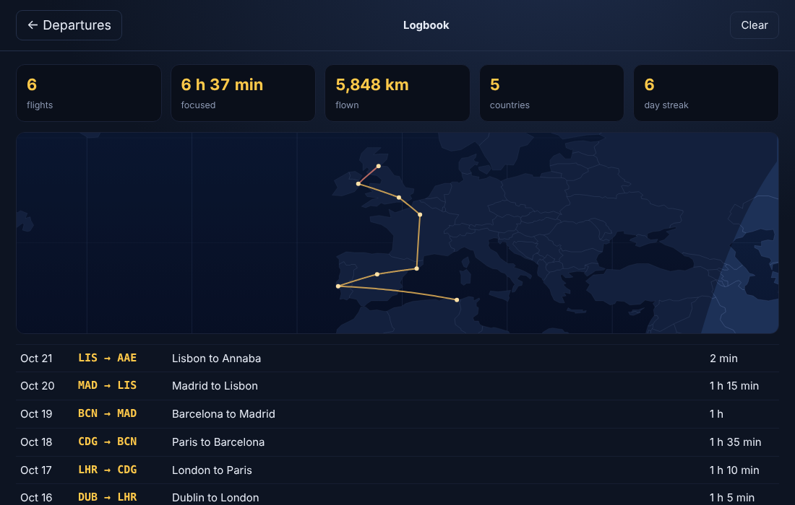
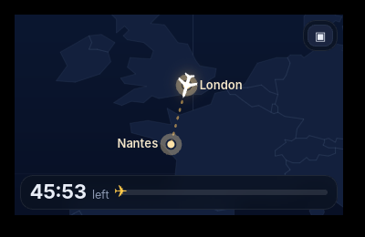

<div align="center">



# Contrail

**A focus timer where every session is a flight.**
Pick how long you want to work, choose a real city about that far away, and fly there while you focus. Land and the city goes in your logbook.
Free and open source. No account, no subscription, nothing leaves your computer.

Windows · macOS · Linux



[Demo video (MP4)](docs/demo.mp4) · [Install](#install) · [How it works](#how-it-works) · [Compared to paid apps](#compared-to-paid-focus-flight-apps)

</div>

---

## Install

**Windows** (PowerShell, installs for your user only, no admin needed):

```powershell
irm https://raw.githubusercontent.com/llamaboi55/contrail/main/scripts/install.ps1 | iex
```

**macOS and Linux:**

```sh
curl -fsSL https://raw.githubusercontent.com/llamaboi55/contrail/main/scripts/install.sh | sh
```

Both commands download the latest release straight from GitHub and install it. Files fetched this way don't get flagged, so there's no "unknown publisher" warning to click through. Run the same command again to update. You can also download the installer for your system from [Releases](https://github.com/llamaboi55/contrail/releases/latest).

**Build it yourself** (needs [Rust](https://rustup.rs) and Node.js 18+; on Linux also the [Tauri packages](https://tauri.app/start/prerequisites/)):

```sh
git clone https://github.com/llamaboi55/contrail && cd contrail && npm install && npm run build
```

**Just try it in a browser** (no install): `npm run preview`, then open the printed address. Add `?fast` to the address to fly 50 times faster.

## How it works

1. **Pick a session length.** 25 minutes, 45, an hour, up to 5 hours, or any number you type.
2. **Pick a flight.** The departures board lists real cities about that far from where you are, out of 1,168 airports in 233 countries. Shuffle for more, or type any city.
3. **Board.** You get a boarding pass with your seat (window or aisle). Then the map takes over: your plane flies the great-circle route, with altitude, ground speed, distance left and the local time where you're going. Day and night move across the map in real time.
4. **Focus.** Optional cabin hum and short announcements from the flight deck at take-off, halfway and the start of descent, so you know when to wrap up.
5. **Land.** A passport stamp, a notification, and your next flight leaves from where you landed, so a week of work becomes a trip across the map.

Need the screen back? **▣** shrinks Contrail to a small window that stays on top in the corner. Have to stop early? **Land early** puts you down at the nearest airport. It still counts, marked as diverted.

The **logbook** keeps every flight with your totals: flights, time focused, distance, countries and your day streak, plus a map of every route you've flown.

| | |
|---|---|
|  |  |
|  |  |
|  |  |

## Compared to paid focus-flight apps

| | Contrail | Typical paid app |
|---|---|---|
| Price | Free | subscription |
| Windows and Linux | ✅ | ❌ iPhone and Mac only |
| Real cities and great-circle routes | ✅ | ✅ |
| Boarding pass, seat choice | ✅ | ✅ |
| Cabin sound and announcements | ✅ | ✅ |
| Live day and night on the map | ✅ | some |
| Small always-on-top window | ✅ | ❌ |
| Logbook and stats | ✅ all free | some behind the paywall |
| Account needed | No | often |
| Open source | ✅ | ❌ |

## Privacy

Everything stays on your computer: your logbook and settings live in the app's local storage. Contrail never connects to the internet. Where you are is just an airport you pick (the first guess comes from your time zone).

## Good to know

- If you close Contrail mid-flight, the flight keeps going. Open it again and you're still in the air, or you've landed.
- Flight times are set so a session lands when you asked: cruise at 820 km/h plus ten minutes of taxi. A 25-minute session flies about 200 km.
- The cabin sound is generated in the app (no recordings), so it loops forever without a seam.

## Development

```sh
npm install
npm run preview      # the whole app in a browser, no Rust build needed
npm run dev          # the real app with hot reload
npm test             # route, timing and logbook tests (node --test) and Rust tests
```

- `src/js/geo.js`: distances, great-circle routes, flight times, picking destinations (tested)
- `src/js/map.js`: the map, day and night, the plane
- `src/js/logbook.js`: the logbook, the flight in progress and settings, stats (tested)
- `src/js/sound.js`: cabin hum and chime, made with Web Audio
- `src/js/app.js`: the departures board, boarding pass, flight, arrival and logbook screens
- `src-tauri/src/lib.rs`: the small always-on-top window, notifications, one running copy

Airport data is from [OurAirports](https://ourairports.com/data/) and the world map is from [Natural Earth](https://www.naturalearthdata.com/), both public domain.

Releases are built for all three systems by GitHub Actions whenever the version in `src-tauri/tauri.conf.json` changes on `main`.

## Where the idea came from

Found through this Instagram Reel: https://www.instagram.com/p/DYtgs4Nup80/ (and similar ones: https://www.instagram.com/p/DTk5P5njHcq/, https://www.instagram.com/p/DZGEjtJJ2Z1/)
This project isn't affiliated with the app shown there.

## License

MIT. Contrail is an independent project and isn't affiliated with any other focus or flight app.
